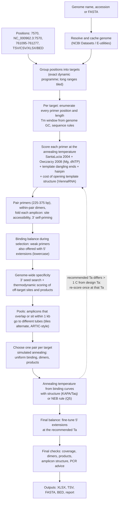

# PrimerJinn

<div>
    
    <p>primerJinn designs primers for multiplex PCR of given target regions in a DNA sequence (FASTA file) and performs in silico PCR given a list of primers and a reference FASTA file. The newer <code>primerjinn-multiplex</code> designs a whole amplicon-sequencing pool from a genome name and a list of positions (see section 3 below).</p>
</div>

[](https://doi.org/10.1186/s12859-023-05609-1)

## Features

- **Multiplex Primer Design**: Design optimal primer sets for multiple target regions
- **Pool design from genome positions** (`primerjinn-multiplex`): NCBI genome lookup, every position covered, binding-matched primers with secondary-structure awareness, genome-wide specificity, automatic pooling and PCR condition advice
- **In Silico PCR**: Simulate PCR reactions with your primers against a reference sequence
- **Primer Interaction Analysis**: Check for primer dimers and cross-reactions
- **Q5 Polymerase Support**: Optimized settings for NEB Q5 hotstart polymerase
- **Illumina Compatibility**: Option to add Illumina partial adapters
- **Comprehensive Output**: Excel workbooks with detailed primer information and interactions

## Installation

```bash
pip install primerJinn
```

### System Requirements

- Python 3.6+
- [BLAST+](https://www.ncbi.nlm.nih.gov/books/NBK569861/)

## Usage

### 1. Multiplex Primer Design

```bash
getMultiPrimerSet \
    --region_file "./example/primer_regions.tsv" \
    --input_file "./example/ref.fasta" \
    --target_tm 65 \
    --primer_len 20 \
    --product_size_min 400 \
    --product_size_max 800 \
    --ret 100 \
    --Q5 \
    --output "example" \
    --output_fasta \
    --exclude_primers
```

### 2. In Silico PCR

```bash
PCRinSilico \
   --primer_seq ./example/primers.txt \
   --target_tm 50 \
   --input_file ./example/ref.fasta \
   --output "in_silico_PCR" \
   --output_fasta \
   --exclude_primers
```

### 3. Multiplex designer from genome positions (`primerjinn-multiplex`)

Designs a multiplex amplicon-sequencing pool from a genome (organism name, NCBI accession or FASTA) and a list of positions. Every position is covered, amplicons are 225 to 375 bp (optimum 300), and primers are matched on Tm and on how strongly they actually bind at the annealing temperature, including template secondary structure. The default polymerase is KAPA2G Robust HotStart ReadyMix.

```bash
python3 -m primerJinn.multiplex.cli \
    --genome "Mycobacterium tuberculosis H37Rv" \
    --positions example/mtb_positions.tsv \
    --out results/mtb
```

After `pip install .` the same command is available as `primerjinn-multiplex`. An example result is in [`example/multiplex_mtb/`](example/multiplex_mtb/mtb_report.md).

#### Graphical interface

A small local web app does the same as the command line:

```bash
pip install ".[gui]"
primerjinn-gui            # or: streamlit run primerJinn/multiplex/gui.py
```

Enter a genome name or upload a FASTA, paste or upload positions (optionally a strain-variant file), choose the polymerase and primer concentration, then **Check positions** (genome lookup and amplicon grouping in seconds) and **Design pool** (runs the command-line tool and streams its log). Results show the PCR conditions and advice, warnings, the primer order table with lowercase 5' extensions highlighted, a genome map of amplicons by pool with a zoomed view of each amplicon (primers, read-covered insert, requested positions), binding-versus-temperature curves for any primer, dimers and products, and downloads (order sheet, XLSX, FASTA, BED, report, ZIP).

#### How it works



#### Reading the primer sequences

Uppercase bases are the Tm-matched core. **Lowercase bases at the 5' end** were added by binding balance (offered to the optimiser during pair selection, so an extension that would form a dimer is avoided by choosing other pairs, and fine-tuned after selection): that primer's template site is folded, so without them it would bind more weakly than the rest of the pool at the annealing temperature. They match the template; the 3' end and the covered positions are unchanged. Order the sequence exactly as written (case does not matter to synthesis). The report lists the core Tm and the full-length Tm, every extended primer, and every weak primer that could not be extended (with the reason, for example a dimer). Use `--no_balance` to turn this off.

#### Main options

| Option | Default | Meaning |
|---|---|---|
| `--genome` | required | Organism name, assembly (GCF_/GCA_) or nucleotide accession, or FASTA path |
| `--positions` | required | File (txt, tsv, csv, xlsx, bed) or inline list; 1-based; use `seqid:pos` when the genome has several chromosomes |
| `--out` | `multiplex` | Output prefix |
| `--polymerase` | `kapa` | `kapa` (KAPA2G Robust ReadyMix), `taq`, `q5`, `hifi` |
| `--primer_nM` | 100 | Concentration of each primer in the pool |
| `--mono_mM`, `--mg_mM`, `--dntp_mM` | 50, preset, 0.8 | Buffer; monovalent = K+ + Na+ + half the Tris |
| `--dmso` | 0 | DMSO % (shifts Tm and Ta) |
| `--tm`, `--tm_window` | from genome GC, 1.5 | Target primer Tm: 65 C at >= 60% GC, 60 C at 30 to 55%, down to 55 C for very AT-rich genomes |
| `--amp_min`, `--amp_opt`, `--amp_max` | 225, 300, 375 | Amplicon length (all within 150 bp of each other) |
| `--tails` | `none` | `illumina`, `nextera`, or `custom` with `--tail_fwd`/`--tail_rev` |
| `--no_balance`, `--max_ext` | on, 8 | Binding balance by 5' extension |
| `--outer_min` | 1000 | Designed amplicons closer than this go to different pools |
| `--no_specificity` | off | Skip the genome-wide off-target check |
| `--variants`, `--variant_min_af` | none, 0 | Known strain variants (VCF, BED, or TSV/CSV/TXT of positions): rejected within 5 nt of a primer's 3' end, penalised elsewhere under a primer |
| `--max_poly`, `--primer_gc_min` | from genome GC | Sequence rules, loosened for AT-rich genomes |
| `--ta` | derived | Force the annealing temperature used for scoring |

#### Strain variants

Give known variants with `--variants` (for example lineage SNPs, or variants called across your isolates) as a VCF, a BED file, or a plain list of positions in the same formats as `--positions`. A primer with a known variant in its last 5 nt at the 3' end is never used; a variant further from the 3' end is allowed but penalised, so cleaner primers win when they exist. 5' extensions from binding balance never grow over a variant. The primers table reports `variants_under_primer`.

#### Outputs

- `<out>_report.md`: recommended PCR conditions (annealing temperature, cycling, additives), warnings, coverage, primers, amplicons, dimers, other products.
- `<out>.xlsx` and one TSV per table: `primers` (order sheet), `amplicons` (structure metrics per amplicon), `dimers`, `products` (outer products, repeated loci, unintended), `offtarget_sites`, `binding_vs_temperature`, `conditions`.
- `<out>_amplicons.fasta` and `<out>.bed` (inserts as thickStart/thickEnd).

#### Accuracy and limits

Primer Tm uses SantaLucia 2004 nearest-neighbour parameters with the Owczarzy 2008 Mg2+ correction. On independent data (Owczarzy 2008 SI, Table S2) it is within 1.6 C on average in PCR-like buffers. That beats primer3's built-in calculation, which also defaults to 0.8 M formamide in primer3-py. Dimer, structure and off-target thresholds are literature and model starting points, not yet calibrated against sequencing depth. Circular replicons are treated as linear. Design decisions, evidence and fact-checked research reports: [`docs/DESIGN.md`](docs/DESIGN.md), [`docs/research/`](docs/research/). Work log and next steps: [`PROGRESS.md`](PROGRESS.md).

## Parameters

### Common Parameters (Both Tools)

| Parameter | Required | Description | Default |
|-----------|----------|-------------|----------|
| `--input_file` | Yes | Reference FASTA file path | NA |
| `--target_tm` | No | Target melting temperature (°C) | 60 |
| `--salt_concentration` | No | Salt concentration (nM, ignored if Q5=True) | 50 |
| `--output` | No | Output file prefix | 'MultiPlexPrimerSet' or 'in_silico_PCR' |
| `--Q5` | No | Use Q5 polymerase settings | False |
| `--output_fasta` | No | Output amplicon sequences in FASTA format | False |
| `--exclude_primers` | No | Exclude primer sequences from FASTA output | False |

### Primer Design Specific Parameters

| Parameter | Required | Description | Default |
|-----------|----------|-------------|----------|
| `--region_file` | Yes | TSV/XLSX file with regions (name, start, end) | NA |
| `--primer_len` | No | Primer length | 20 |
| `--product_size_min` | No | Minimum amplicon size | 400 |
| `--product_size_max` | No | Maximum amplicon size | 800 |
| `--ret` | No | Maximum primer pairs to return | 100 |
| `--background` | No | Mispriming library FASTA | None |
| `--ill_adapt` | No | Add Illumina partial adapters | False |
| `--clamp` | No | Require GC clamp | 0 |
| `--poly` | No | Max mononucleotide repeat length | 3 |
| `--no_self_background` | No | Skip self-mispriming check | False |

### In Silico PCR Specific Parameters

| Parameter | Required | Description | Default |
|-----------|----------|-------------|----------|
| `--primer_seq` | Yes | File with primer sequences | NA |
| `--product_size_max` | No | Maximum amplicon size | 2000 |
| `--req_five` | No | Require 5' end binding | True |
| `--output_fasta` | No | Output amplicons in FASTA | False |
| `--exclude_primers` | No | Exclude primers from FASTA output | False |

## Output Files

### Multiplex Primer Design
- `MultiPlexPrimerSet.xlsx`: Contains primer pairs, Tm values, and product sizes
- `MultiPlexPrimerSet_amplicons.fasta`: (Optional) FASTA file of amplicon sequences

### In Silico PCR
- `in_silico_PCR.xlsx`: Excel workbook with multiple sheets:
  - `amplicons`: Predicted PCR products
  - `dimers`: Potential primer-dimer interactions
  - `interactions`: Cross-reactions between amplicons
- `in_silico_PCR_amplicons.fasta`: (Optional) FASTA file of predicted amplicons

The FASTA output files contain:
- Headers in format: `>target_name_start_end_length`
- Sequences either:
  - Include primers (default)
  - Exclude primers (with `--exclude_primers`)

## Testing Recommendations

When validating primers for diagnostic assays:
1. Perform qPCR with individual primer pairs
2. Use EVA Green plus (20X in water) and ROX (50X)
3. Analyze melt curves
4. Confirm single bands via agarose gel electrophoresis

## Online Version

A web version of primerJinn's getMultiPrimerSet is available at [DrDx.Me](https://drdx.ucsf.edu/)

## Citation

Limberis, J.D., Metcalfe, J.Z. primerJinn: a tool for rationally designing multiplex PCR primer sets for amplicon sequencing and performing in silico PCR. BMC Bioinformatics 24, 468 (2023). [https://doi.org/10.1186/s12859-023-05609-1](https://doi.org/10.1186/s12859-023-05609-1)

## Author

Jason Limberis (JasonLimberis@ucsf.edu)

## License

This project is licensed under the MIT License.