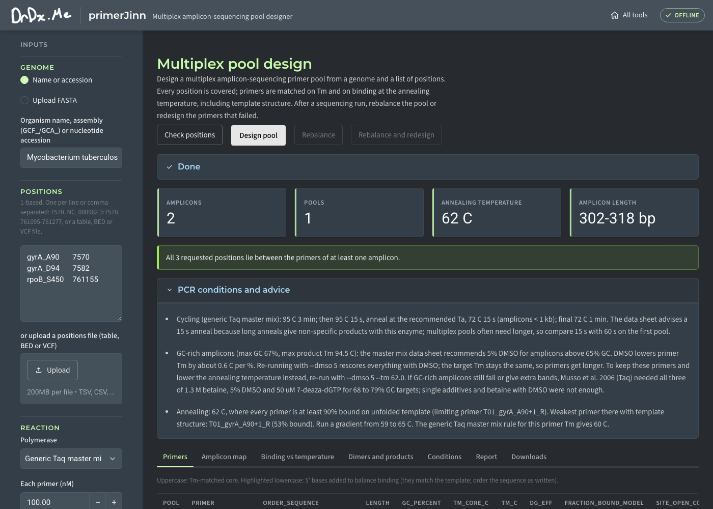
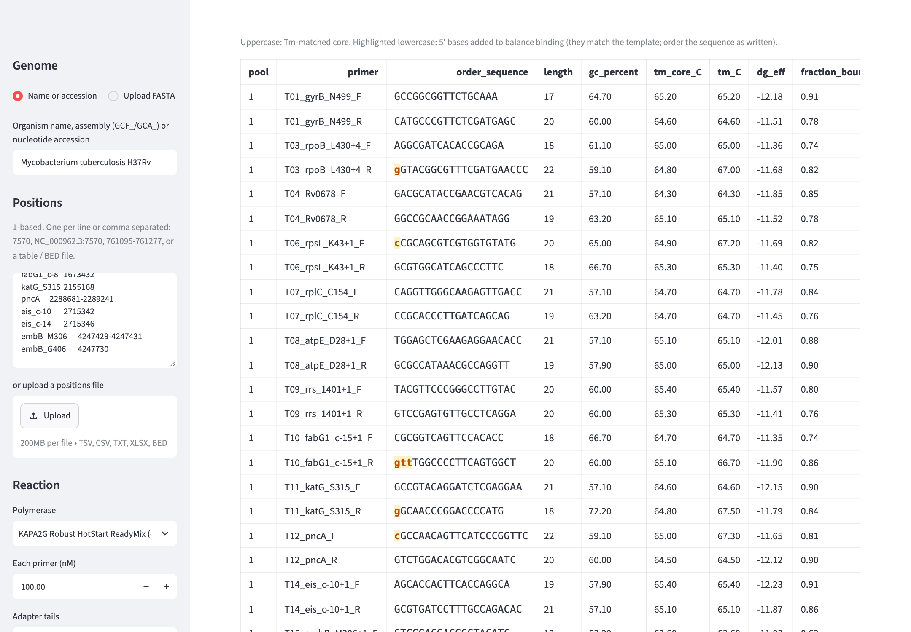
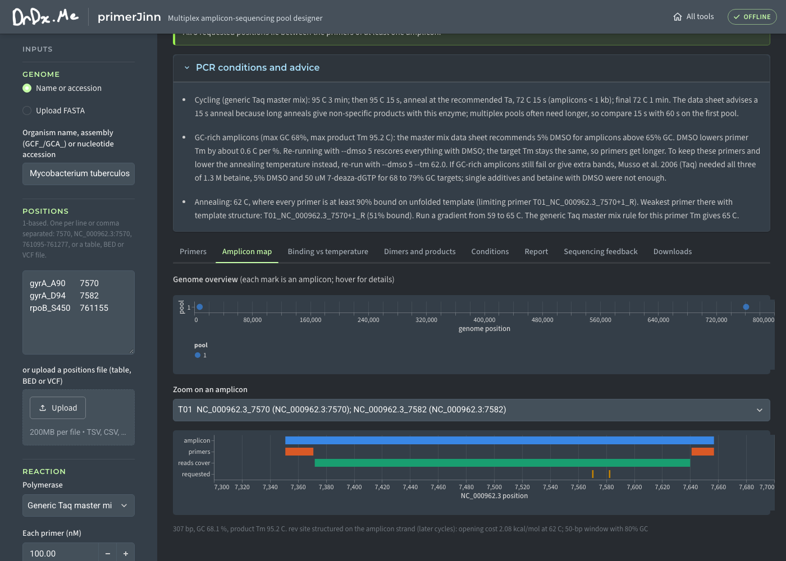
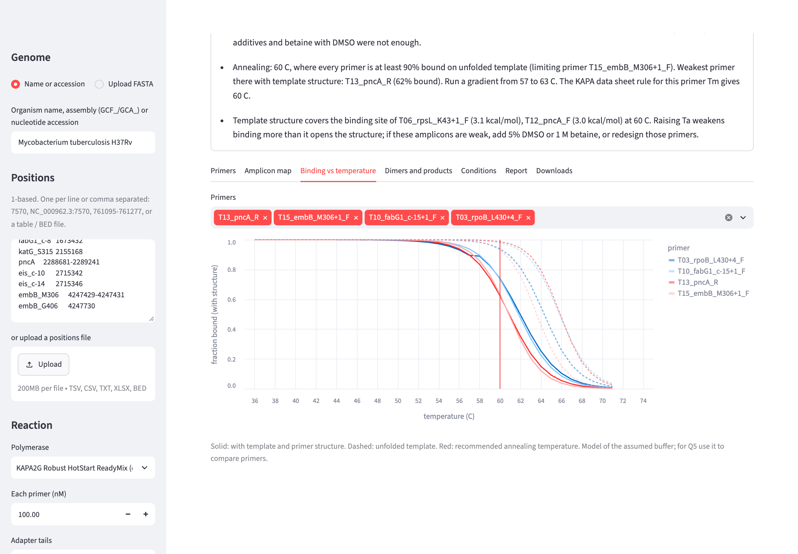
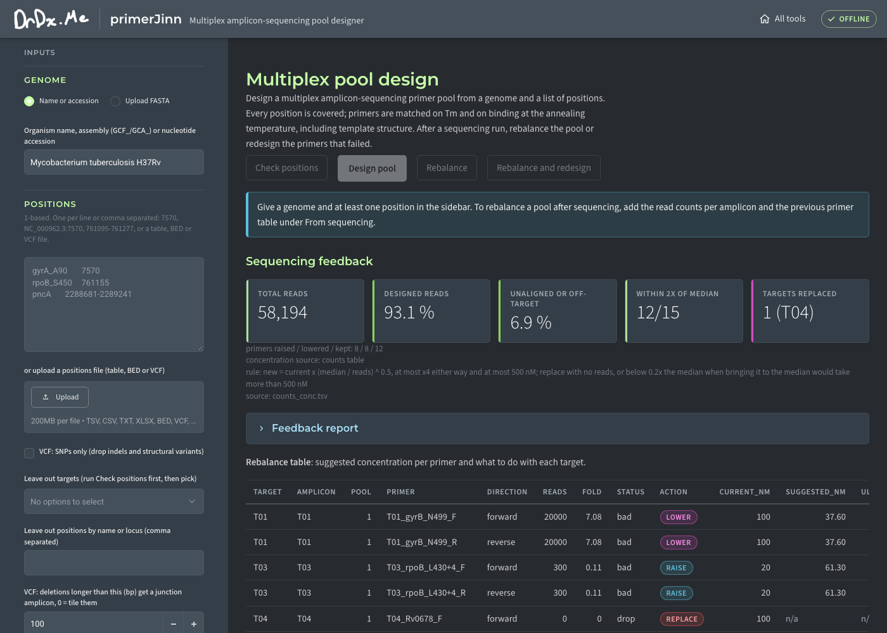
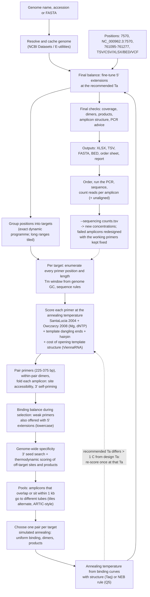

# PrimerJinn

<div>
    
    <p>primerJinn designs primers for multiplex PCR of given target regions in a DNA sequence (FASTA file) and performs in silico PCR given a list of primers and a reference FASTA file. The newer <code>primerjinn-multiplex</code> designs a whole amplicon-sequencing pool from a genome name and a list of positions (see section 3 below).</p>
</div>

[](https://doi.org/10.1186/s12859-023-05609-1)

## Features

- **Multiplex Primer Design**: Design optimal primer sets for multiple target regions
- **Pool design from genome positions** (`primerjinn-multiplex`): NCBI genome lookup, every position covered, binding-matched primers with secondary-structure awareness, genome-wide specificity, automatic pooling and PCR condition advice
- **Feedback from sequencing**: from a table of read counts per amplicon, rebalance primer concentrations and redesign only the amplicons that failed, keeping the primers that work
- **In Silico PCR**: Simulate PCR reactions with your primers against a reference sequence
- **Primer Interaction Analysis**: Check for primer dimers and cross-reactions
- **Q5 Polymerase Support**: Optimized settings for NEB Q5 hotstart polymerase
- **Illumina Compatibility**: Option to add Illumina partial adapters
- **Comprehensive Output**: Excel workbooks with detailed primer information and interactions

## Installation

From PyPI (the 2.1 release is being prepared; until it is on PyPI, use the clone below):

```bash
pip install "primerJinn[gui]"        # the multiplex designer, its GUI and the original tools
```

ViennaRNA, pysam, numba and primer3-py come as wheels on Linux and macOS. BLAST+ is needed only by the original tools (`getMultiPrimerSet`, `PCRinSilico`); install it with conda (`bioconda::blast`) or from NCBI.

With conda (conda, mamba or micromamba), which also brings BLAST+ and keeps every compiled dependency from one channel:

```bash
git clone https://github.com/SemiQuant/PrimerJinn.git
cd PrimerJinn
micromamba create -f environment.yml      # or: mamba env create -f environment.yml
micromamba activate primerjinn
pip install --no-deps -e .
```

Keep `--no-deps` there. Mixing conda and pip copies of the same package is what breaks installs: for example a conda numba with a pip llvmlite fails with "Numba requires at least version ... of llvmlite". If that happens in an existing environment, reinstall both with the tool that manages it (`micromamba install -c conda-forge numba llvmlite`), or use the environment above. A bioconda recipe is in `conda/` (see `docs/RELEASE.md`); once it is published, `conda install -c conda-forge -c bioconda primerjinn` replaces the steps above.

### System Requirements

- Python 3.10+ (the environment uses 3.12)
- [BLAST+](https://www.ncbi.nlm.nih.gov/books/NBK569861/) for the original tools (included in the conda environment)

## Usage

### 1. Multiplex Primer Design

```bash
getMultiPrimerSet \
    --region_file "./example/primer_regions.tsv" \
    --input_file "./example/ref.fasta" \
    --target_tm 65 \
    --primer_len 20 \
    --product_size_min 400 \
    --product_size_max 800 \
    --ret 100 \
    --Q5 \
    --output "example" \
    --output_fasta \
    --exclude_primers
```

### 2. In Silico PCR

```bash
PCRinSilico \
   --primer_seq ./example/primers.txt \
   --target_tm 50 \
   --input_file ./example/ref.fasta \
   --output "in_silico_PCR" \
   --output_fasta \
   --exclude_primers
```

### 3. Multiplex designer from genome positions (`primerjinn-multiplex`)

Designs a multiplex amplicon-sequencing pool from a genome (organism name, NCBI accession or FASTA) and a list of positions. Every position is covered, amplicons are 225 to 375 bp (optimum 300), and primers are matched on Tm and on how strongly they actually bind at the annealing temperature, including template secondary structure. The default polymerase preset is a generic Taq master mix (hot start, 2 mM Mg2+).

```bash
python3 -m primerJinn.multiplex.cli \
    --genome "Mycobacterium tuberculosis H37Rv" \
    --positions example/mtb_positions.tsv \
    --out results/mtb
```

After installation the same command is available as `primerjinn-multiplex`. An example result is in [`example/multiplex_mtb/`](example/multiplex_mtb/mtb_report.md).

#### Graphical interface

A small local web app does the same as the command line:

```bash
pip install "primerJinn[gui]"   # in the conda environment: pip install --no-deps -e . (streamlit comes from environment.yml)
primerjinn-gui                # opens http://localhost:8501 in the browser
primerjinn-gui --server.port 8600   # any streamlit option can follow
```

From the repository folder `streamlit run primerJinn/multiplex/gui.py` does the same (`.streamlit/config.toml` carries the theme). Stop it with Ctrl+C. Nothing is uploaded anywhere: the app and the designer run on this computer; only a genome given by name or accession is fetched from NCBI once and cached.

Enter a genome name or upload a FASTA, paste or upload positions (optionally a strain-variant file), choose the polymerase and primer concentration, then **Check positions** (genome lookup and amplicon grouping in seconds) and **Design pool** (runs the command-line tool and streams its log). Results show the PCR conditions and advice, warnings, the primer order table with lowercase 5' extensions highlighted, a genome map of amplicons by pool with a zoomed view of each amplicon (primers, read-covered insert, requested positions), binding-versus-temperature curves for any primer, dimers and products, and downloads (order sheet, XLSX, FASTA, BED, report, ZIP). After sequencing, the **From sequencing** step takes the run analysis and the previous design and gives new concentrations and, if needed, a redesign (see [After sequencing](#after-sequencing-rebalance-and-redesign)). The app runs on this computer only; it looks like the other [DrDx.Me](https://drdx.me) tools.



<details>
<summary>More screenshots: primer table, amplicon map, binding curves</summary>

The primer order table. Highlighted lowercase bases are 5' extensions added to balance binding.



Amplicons across the genome by pool, and a zoom on one amplicon: primers, the insert the reads cover, and the requested position.



Fraction of each primer bound against temperature, with template structure (solid) and on unfolded template (dashed). The red line is the recommended annealing temperature.



After sequencing: the run summary, the rebalance table with an action per primer, and the reasons per target.



</details>

#### How it works



#### Reading the primer sequences

Uppercase bases are the Tm-matched core. **Lowercase bases at the 5' end** were added by binding balance (offered to the optimiser during pair selection, so an extension that would form a dimer is avoided by choosing other pairs, and fine-tuned after selection): that primer's template site is folded, so without them it would bind more weakly than the rest of the pool at the annealing temperature. They match the template; the 3' end and the covered positions are unchanged. Order the sequence exactly as written (case does not matter to synthesis). The report lists the core Tm and the full-length Tm, every extended primer, and every weak primer that could not be extended (with the reason, for example a dimer). Use `--no_balance` to turn this off.

#### Main options

| Option | Default | Meaning |
|---|---|---|
| `--genome` | required | Organism name, assembly (GCF_/GCA_) or nucleotide accession, or FASTA path |
| `--positions` | required | File (txt, tsv, csv, xlsx, BED or VCF) or inline list; 1-based (BED is converted); use `seqid:pos` when the genome has several chromosomes. A VCF gives one target per record, covering its REF allele |
| `--check` | off | Check the inputs, report every problem, and stop without designing (see below) |
| `--exclude` | none | Positions to leave out: names, loci (`seqid:pos`, `start-end`) or target ids from `--check` (`T03`, `J01`); comma list or file. In the GUI, pick targets from the last check under Positions |
| `--vcf_snps_only` | off | From a VCF use only single-base variants (REF and ALT one base); indels and structural variants are left out |
| `--vcf_max_indel` | 0 (off) | Leave out VCF records whose REF and ALT differ in length by more than this many bp (structural variants count their span); GUI: Advanced |
| `--long_variant` | 100 | A VCF deletion longer than this (bp) gets a junction amplicon instead of being tiled (see below); 0 tiles every record |
| `--out` | `multiplex` | Output prefix |
| `--polymerase` | `kapa` | `kapa` (generic Taq master mix: hot start, 2 mM Mg2+), `taq` (1.5 mM Mg2+), `q5`, `hifi` |
| `--primer_nM` | 100 | Concentration of each primer in the pool |
| `--mono_mM`, `--mg_mM`, `--dntp_mM` | 50, preset, 0.8 | Buffer; monovalent = K+ + Na+ + half the Tris |
| `--dmso` | 0 | DMSO % (shifts Tm and Ta) |
| `--tm`, `--tm_window` | from genome GC, 1.5 | Target primer Tm: 65 C at >= 60% GC, 60 C at 30 to 55%, down to 55 C for very AT-rich genomes |
| `--amp_min`, `--amp_opt`, `--amp_max` | 225, 300, 375 | Amplicon length (all within 150 bp of each other) |
| `--tails` | `none` | `illumina`, `nextera`, or `custom` with `--tail_fwd`/`--tail_rev` |
| `--no_balance`, `--max_ext` | on, 8 | Binding balance by 5' extension |
| `--outer_min` | 1000 | Designed amplicons closer than this go to different pools |
| `--one_pool`, `--one_pool_max` | off, 1000 | Force a single pool: targets that may not share a tube merge into one amplicon; only those get a larger size class (see below). Targets that still cannot be merged within the cap go to a second pool with a warning |
| `--one_pool_drop` | off | With `--one_pool`: drop the targets that would need a second pool instead of adding it (they are listed in the report) |
| `--no_specificity` | off | Skip the genome-wide off-target check |
| `--variants`, `--variant_min_af` | none, 0 | Known strain variants (VCF, BED, or TSV/CSV/TXT of positions): rejected within 5 nt of a primer's 3' end, penalised elsewhere under a primer |
| `--max_poly`, `--primer_gc_min` | from genome GC | Sequence rules, loosened for AT-rich genomes |
| `--ta` | derived | Force the annealing temperature used for scoring |
| `--sequencing`, `--previous` | none | After sequencing: the read counts per amplicon (`counts.tsv`) and the sequenced design's `_primers.tsv`; rebalances concentrations and redesigns failed amplicons (see below) |
| `--conc` | none | `primer<TAB>conc_nM` actually used in the sequenced pool, per primer (or a `conc_nM` column in the counts table; default: the previous design's setting) |
| `--replace`, `--keep` | none | Target ids to redesign or keep regardless of the data (comma list or file) |
| `--no_redesign` | off | Write the concentration suggestions only |
| `--redesign_below`, `--conc_max` | 0.2, 500 | An amplicon below this fold of the median is weak; it is redesigned when its primers would need more than `--conc_max` nM to reach the median, raised otherwise (no reads: always redesigned) |
| `--alpha`, `--cap` | 0.5, 4 | Damping and limit of the concentration change |
| `--reaction_ul`, `--stock_uM` | 25, 10 | For the stock volumes per reaction in the rebalance table |

#### VCF input: SNPs only, and long deletions

A VCF gives one target per record covering its REF allele. `--vcf_snps_only` keeps only records whose REF and ALT are single bases (the GUI has the same checkbox), which is the right choice when the VCF is a catalogue that also lists indels and structural variants you do not want in the panel. `--vcf_max_indel N` is the softer filter: it keeps SNPs and short indels and leaves out records whose alleles differ in length by more than N bp (a symbolic allele counts its span).

A deletion longer than `--long_variant` (default 100 bp) is not tiled. Tiling a deleted region with overlapping amplicons only shows the deletion as amplicon dropout, which looks the same as a failed PCR, and with `--one_pool` the overlapping tiles cannot share a tube. Instead the designer makes a **junction amplicon**: the forward primer upstream of the deletion, the reverse primer downstream, and the product length and sequence computed on the deleted allele (the reference with the deleted bases removed), so the product is a normal 225 to 375 bp amplicon when the deletion is present. On wild type the primers are the deletion length further apart (`wildtype_product_bp` in the amplicons table, typically 0.5 to 3 kb) and a 15 s extension does not make that product. Reads spanning the junction give the exact breakpoints. A missing junction product therefore means wild type or a failed reaction, so read it alongside a standard amplicon nearby. Junction targets are named `J01`, `J02` ... and listed with `kind = junction` in the amplicons table; the FASTA holds the deleted-allele sequence, the BED the genomic span. They overlap the deletion they span, so under `--one_pool` they may need their own pool (the report says so). Short indels and MNPs stay ordinary targets. Insertions, inversions and other structural variants are treated as before (a range to cover).

#### Input check

Every run starts by checking all inputs, and `--check` runs only this check (a few seconds; exit code 0 if nothing is wrong, 2 if something must be fixed). It lists every problem at once rather than stopping at the first:

- software: ViennaRNA, primer3, pysam and numba load (a broken numba install is reported with the fix);
- genome: it resolves, with its size, sequences and GC;
- positions: the file format, every row that cannot be read, sequence names that are not in the genome (with the likely cause, for example `NC_000962.2` against a genome that has `NC_000962.3`), positions past a sequence end, positions in N gaps or on ambiguity codes, positions too close to a sequence end for an amplicon, and how the positions group into amplicons;
- VCF files: REF alleles are compared with the genome bases and `##contig` lengths with the genome's sequence lengths. Most REF alleles differing means the VCF was made on another reference or version, which is an error; a few differing is a warning listing them;
- tables: if every range is 2 bp with end = start + 1, the file is probably 0-based BED-style coordinates saved as a table;
- variants (`--variants`): the same file and name checks, and how many requested positions carry a known variant;
- settings and output: the settings are valid and the output folder can be written.

```bash
primerjinn-multiplex --genome "Mycobacterium tuberculosis H37Rv" --positions my_mutations.vcf --check
```

In the GUI, **Check positions** shows the same report. `getMultiPrimerSet --check` runs the matching checks for the original tool: one sequence in the FASTA, regions readable and inside it, no overlapping regions, and regions no longer than `--product_size_max`.

#### One pool

By default, targets closer than `--outer_min` (and overlapping tiles of a long range) go to different pools, because in one tube they form short outer products or overlap. `--one_pool` puts everything in one tube instead. Targets that may not share a tube are merged into one amplicon. Everything else keeps the normal 225-375 bp window, and only merged targets that need more room get a larger size class. Each class has the same 150 bp spread and ends at the longest length it needs, so amplicons are balanced within each class and none is longer than necessary (at most `--one_pool_max`, default 1000 bp).

When a stretch is so densely covered that its tiles must overlap and cannot be merged within `--one_pool_max` (a whole gene full of catalogue variants, for example), the layout no longer fails: those targets stay separate and the design uses a second pool for them, which the input check and the report point out. `--one_pool_drop` drops them instead, and `--exclude` lets you leave out chosen positions or targets by hand. With `--one_pool` the input check also forecasts the number of pools the design will need and names the targets that cannot share the first tube, so you can decide before designing. Junction amplicons (long deletions) overlap every amplicon inside their deletion, so they are the usual cause of extra pools; a deletion that lies inside one standard amplicon gets no junction amplicon, because that amplicon shows the deletion by itself (the input check names it, and the junction amplicons that are made are numbered J01, J02, ... without gaps). In the GUI the check result stays on screen until you check again, so after changing a setting such as Force one pool it says the check is stale: check again before designing. For nanopore reads a larger `--one_pool_max` (2500 bp, say) lets a densely covered gene become one long amplicon, which removes most of these conflicts.

For the 24 M. tuberculosis example positions this gives 9 amplicons of 225-375 bp, 2 of 475-625 bp (Rv0678 and pncA, whole ranges that would otherwise be overlapping tiles) and 1 of 775-925 bp (gyrB 6735 with gyrA 7570-7582, 835 bp apart). The amplicon table has a `size_class_bp` column. Longer amplicons usually amplify less well in a mixed pool, so compare read depth after a first run and raise those primers' concentration if needed. With `--outer_min 700` (shorter outer products tolerated in the tube), gyrB and gyrA stay separate amplicons. The input check warns when amplicons exceed 600 bp (reads must be long enough to reach the requested positions), and if `--one_pool_max` is too small it names the targets and the size they need.

#### Strain variants

Give known variants with `--variants` (for example lineage SNPs, or variants called across your isolates) as a VCF, a BED file, or a plain list of positions in the same formats as `--positions`. A primer with a known variant in its last 5 nt at the 3' end is never used; a variant further from the 3' end is allowed but penalised, so cleaner primers win when they exist. 5' extensions from binding balance never grow over a variant. The primers table reports `variants_under_primer`.

#### After sequencing: rebalance and redesign

Order the pool, run the PCR, sequence it, and count the reads per amplicon with whatever pipeline you use (align the reads to the genome or to `<out>_amplicons.fasta`, count the reads per designed product). Put the counts in one small table, `counts.tsv`:

```
amplicon        reads
T01_gyrB_N499   12400
T02_gyrA_A90    3100
T03_rpoB_RRDR   0
unaligned       5200
```

With the concentrations used (optional):

```
amplicon        reads   conc_nM
T01_gyrB_N499   12400   100
T02_gyrA_A90    3100    200
T03_rpoB_RRDR   0       100
unaligned       5200
```

- `amplicon`: the primerJinn target id (`T01`), the primer name without its `_F`/`_R` (`T01_gyrB_N499`), or the target name. `A/B` names two amplicons that were counted together.
- `reads`: reads that are the designed product (full or partial). Tab or comma separated, one header row; `count` or `n_reads` are accepted for `reads`, `target` or `name` for `amplicon`.
- `unaligned`: a row with the reads that match no designed amplicon (unmapped reads, primer dimers, off-target products). Count them, do not drop them: without this row primerJinn cannot tell a good library from one that is mostly dimers. Rows named `off_target` or `dimer` are accepted too if you want to split them.
- Optional `conc_nM` column: the concentration each primer of that amplicon was used at. This decides between a new concentration and a new pair: a weak amplicon whose primers were dilute is raised, one that is weak although its primers would need more than `--conc_max` (500 nM) to reach the median is redesigned. Without it the previous design's setting is assumed for every primer (`--conc` gives a per-primer table instead).
- Optional `sample` column: one row per sample and amplicon; folds are pooled over samples (geometric mean).

Then feed it back together with the sequenced design's primer table:

```bash
primerjinn-multiplex --genome "Mycobacterium tuberculosis H37Rv" --positions example/mtb_positions.tsv \
    --sequencing counts.tsv --previous results/mtb_primers.tsv --out results/mtb_v2
```

What happens:

1. **Match.** Rows are matched to the previous design's targets by name (ids, primer names or target names, case-insensitive). Unmatched rows and targets without a row are reported; a target without a row counts as no reads.
2. **Decide per amplicon.** Replace when it had no reads. An amplicon below `--redesign_below` (0.2) of the median is weak: if `current x median / reads` stays within `--conc_max` (500 nM) its primers are raised (concentration first, redesign later), otherwise the pair is replaced; a pair already at `--conc_max` and still under half the median is replaced too. Everything else is rebalanced. `--replace` and `--keep` override.
3. **Rebalance.** For kept primers the new concentration is `current x (median / reads) ^ 0.5`, at most x4 either way (`--alpha`, `--cap`) and never above `--conc_max`, with the stock volume per reaction (`--reaction_ul`, `--stock_uM`). Over-amplifying amplicons are lowered, weak ones raised. `--conc` gives the concentrations actually used when they were not all the design default.
4. **Redesign.** The replaced amplicons are designed again against the kept primers: kept pairs enter the designer as fixed candidates, so dimers, outer products and genome-wide specificity are checked between new and kept primers, kept primers are never extended, and pool numbers are kept. The failed primers' 3' ends are excluded and their sites penalised. Positions and genome must be the same as for the previous design (ids are checked). With `--no_redesign`, or when nothing needs replacing, only the concentration tables are written (seconds).

Outputs: `<out>_rebalance.tsv` (per primer: reads, fold, status, action keep/raise/lower/replace with the reason, current and suggested nM, stock volume), `<out>_rebalance_targets.tsv`, `<out>_conc.tsv` (`primer`, `conc_nM`; new primers at the design concentration), `<out>_feedback.tsv` and `.md` (run summary: total reads, designed %, unaligned %, amplicons within 2x, warnings), and after a redesign the full new design plus `<out>_order_sheet_new.tsv` with only the primers to order. The report's conditions table records which targets were kept and which were designed afresh. Fewer than about 200 reads per amplicon, or more than 30 % of reads outside the designed amplicons, give a warning: the fold changes are then mostly noise. An example counts table is in [`example/sequencing_run/`](example/sequencing_run/).

#### Outputs

- `<out>_report.md`: recommended PCR conditions (annealing temperature, cycling, additives), warnings, coverage, primers, amplicons, dimers, other products.
- `<out>.xlsx` and one TSV per table: `primers` (order sheet with every metric), `amplicons` (structure metrics per amplicon; `kind`, `deletion` and `wildtype_product_bp` for junction amplicons), `dimers`, `products` (outer products, repeated loci, unintended), `offtarget_sites`, `binding_vs_temperature`, `conditions`.
- `<out>_order_sheet.tsv`: forward name, forward sequence, reverse name, reverse sequence, one amplicon per row (what vendors take); after a redesign also `<out>_order_sheet_new.tsv` with the new primers only.
- `<out>_map.png`: the amplicon map (genome overview by pool, and every amplicon with its primers, insert, requested positions and any spanned deletion), embedded in the report.
- `<out>_amplicons.fasta` and `<out>.bed` (inserts as thickStart/thickEnd).
- `<out>_uncovered.tsv` (only when something is missing): every requested position no amplicon covers, with the reason (N in the reference, dropped by `--one_pool_drop`, or not between any primers). The GUI shows the same list under the coverage line.
- With `--sequencing`: `<out>_rebalance.tsv`, `<out>_rebalance_targets.tsv`, `<out>_conc.tsv`, `<out>_feedback.tsv`, `<out>_feedback.md` (see above).

#### Accuracy and limits

Primer Tm uses SantaLucia 2004 nearest-neighbour parameters with the Owczarzy 2008 Mg2+ correction. On independent data (Owczarzy 2008 SI, Table S2) it is within 1.6 C on average in PCR-like buffers. That beats primer3's built-in calculation, which also defaults to 0.8 M formamide in primer3-py. Dimer, structure and off-target thresholds are literature and model starting points, not yet calibrated against sequencing depth; the sequencing feedback step is how that calibration starts. Circular replicons are treated as linear. Design decisions, evidence and fact-checked research reports: [`docs/DESIGN.md`](docs/DESIGN.md), [`docs/research/`](docs/research/). Work log and next steps: [`PROGRESS.md`](PROGRESS.md).

## Parameters

### Common Parameters (Both Tools)

| Parameter | Required | Description | Default |
|-----------|----------|-------------|----------|
| `--input_file` | Yes | Reference FASTA file path | NA |
| `--target_tm` | No | Target melting temperature (°C) | 60 |
| `--salt_concentration` | No | Salt concentration (nM, ignored if Q5=True) | 50 |
| `--output` | No | Output file prefix | 'MultiPlexPrimerSet' or 'in_silico_PCR' |
| `--Q5` | No | Use Q5 polymerase settings | False |
| `--output_fasta` | No | Output amplicon sequences in FASTA format | False |
| `--exclude_primers` | No | Exclude primer sequences from FASTA output | False |

### Primer Design Specific Parameters

| Parameter | Required | Description | Default |
|-----------|----------|-------------|----------|
| `--region_file` | Yes | Regions: TSV/CSV/XLSX table with start and end columns (1-based), BED (0-based, converted) or VCF (one region per record, covering its REF allele) | NA |
| `--check` | No | Check the FASTA and region file, report every problem, and stop | False |
| `--primer_len` | No | Primer length | 20 |
| `--product_size_min` | No | Minimum amplicon size | 400 |
| `--product_size_max` | No | Maximum amplicon size | 800 |
| `--ret` | No | Maximum primer pairs to return | 100 |
| `--background` | No | Mispriming library FASTA | None |
| `--ill_adapt` | No | Add Illumina partial adapters | False |
| `--clamp` | No | Require GC clamp | 0 |
| `--poly` | No | Max mononucleotide repeat length | 3 |
| `--no_self_background` | No | Skip self-mispriming check | False |

### In Silico PCR Specific Parameters

| Parameter | Required | Description | Default |
|-----------|----------|-------------|----------|
| `--primer_seq` | Yes | File with primer sequences | NA |
| `--product_size_max` | No | Maximum amplicon size | 2000 |
| `--req_five` | No | Require 5' end binding | True |
| `--output_fasta` | No | Output amplicons in FASTA | False |
| `--exclude_primers` | No | Exclude primers from FASTA output | False |

## Output Files

### Multiplex Primer Design
- `MultiPlexPrimerSet.xlsx`: Contains primer pairs, Tm values, and product sizes
- `MultiPlexPrimerSet_amplicons.fasta`: (Optional) FASTA file of amplicon sequences

### In Silico PCR
- `in_silico_PCR.xlsx`: Excel workbook with multiple sheets:
  - `amplicons`: Predicted PCR products
  - `dimers`: Potential primer-dimer interactions
  - `interactions`: Cross-reactions between amplicons
- `in_silico_PCR_amplicons.fasta`: (Optional) FASTA file of predicted amplicons

The FASTA output files contain:
- Headers in format: `>target_name_start_end_length`
- Sequences either:
  - Include primers (default)
  - Exclude primers (with `--exclude_primers`)

## Testing Recommendations

When validating primers for diagnostic assays:
1. Perform qPCR with individual primer pairs
2. Use EVA Green plus (20X in water) and ROX (50X)
3. Analyze melt curves
4. Confirm single bands via agarose gel electrophoresis

## Online Version

A web version of primerJinn's getMultiPrimerSet is available at [DrDx.Me](https://drdx.ucsf.edu/)

## Citation

Limberis, J.D., Metcalfe, J.Z. primerJinn: a tool for rationally designing multiplex PCR primer sets for amplicon sequencing and performing in silico PCR. BMC Bioinformatics 24, 468 (2023). [https://doi.org/10.1186/s12859-023-05609-1](https://doi.org/10.1186/s12859-023-05609-1)

## Author

Jason Limberis (JasonLimberis@ucsf.edu)

## License

This project is licensed under the MIT License.