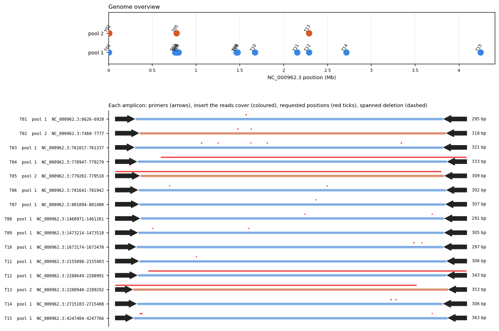

# Multiplex primer design report

## PCR conditions

| Item | Value |
|---|---|
| genome | /Users/semiquant/Bioinformatics/Projects/Archived/PrimerJinn/example/ref.fasta |
| genome GC % | 65.61 |
| polymerase preset | kapa (generic Taq master mix (hot start, 2 mM Mg2+)) |
| Tm scale | physical: SantaLucia 2004 + Owczarzy 2008 in the assumed buffer at the primer concentration |
| target primer Tm | 65.0 +/- 1.5 C |
| primer Tm range in pool | 63.6 to 67.5 C |
| same primers on the NEB Q5 calculator scale | 68.0 to 72.6 C |
| assumed buffer | 50 mM monovalent, 2 mM Mg2+, 0.8 mM dNTP total, 0% DMSO |
| primer concentration | 100 nM each |
| RECOMMENDED annealing temperature | 60 C |
| temperature primers, structure and off-target sites were scored at | 61.0 C |
| genome-wide specificity | checked |
| known strain variants kept out of primer 3' ends | none given |
| vendor rule Ta (generic Taq master mix: 55/60/65 C for primer Tm <55/55-65/>65) | 60.0 |
| equilibrium model Ta: all primers >= 90% bound on unfolded template, capped where structure leaves the weakest primer at 50% | 60 |
| temperature where every primer is >= 90% bound including structure (model) | 56 |
| temperature where every primer is >= 50% bound (model) | 60 |
| 90% binding temperature without template structure (model) | 60 |
| primer that limits the model Ta (first below the binding criterion) | T15_embB_M306+1_F |
| weakest primer at the recommended Ta, with template structure | T13_pncA_R (62% bound) |
| dG_eff spread at 60 C (kcal/mol): full range / middle 50% | 1.22 / 0.39 |
| pools | 2 |
| amplicons | 15 |
| amplicon length range | 291 to 363 bp |
| adapter tails | none |
| optimiser | annealing, energy 126.7 |
| advice | Cycling (generic Taq master mix): 95 C 3 min; then 95 C 15 s, anneal at the recommended Ta, 72 C 15 s (amplicons < 1 kb); final 72 C 1 min. The data sheet advises a 15 s anneal because long anneals give non-specific products with this enzyme; multiplex pools often need longer, so compare 15 s with 60 s on the first pool. |
| advice | GC-rich amplicons (max GC 67%, max product Tm 95.1 C): the master mix data sheet recommends 5% DMSO for amplicons above 65% GC. DMSO lowers primer Tm by about 0.6 C per %. Re-running with --dmso 5 rescores everything with DMSO; the target Tm stays the same, so primers get longer. To keep these primers and lower the annealing temperature instead, re-run with --dmso 5 --tm 62.0. If GC-rich amplicons still fail or give extra bands, Musso et al. 2006 (Taq) needed all three of 1.3 M betaine, 5% DMSO and 50 uM 7-deaza-dGTP for 68 to 79% GC targets; single additives and betaine with DMSO were not enough. |
| advice | Annealing: 60 C, where every primer is at least 90% bound on unfolded template (limiting primer T15_embB_M306+1_F). Weakest primer there with template structure: T13_pncA_R (62% bound). Run a gradient from 57 to 63 C. The generic Taq master mix rule for this primer Tm gives 60 C. |
| advice | Template structure covers the binding site of T06_rpsL_K43+1_F (3.1 kcal/mol), T12_pncA_F (3.0 kcal/mol) at 60 C. Raising Ta weakens binding more than it opens the structure; if these amplicons are weak, add 5% DMSO or 1 M betaine, or redesign those primers. |

## Coverage

All 24 requested positions lie between the primers of at least one amplicon.

Binding balance: these primers keep their Tm-matched core (uppercase) and carry extra template-matching bases at the 5' end (lowercase), because they would otherwise bind more weakly than the rest of the pool at the annealing temperature (usually a folded template site). The 3' end and the covered positions are unchanged.

- T03_rpoB_L430+4_R: +1 nt at the 5' end, chosen during pair selection (dG_eff -11.24 kcal/mol at 61 C, pool median -11.32)
- T06_rpsL_K43+1_F: +1 nt at the 5' end, chosen during pair selection (dG_eff -11.33 kcal/mol at 61 C, pool median -11.32)
- T10_fabG1_c-15+1_R: +3 nt at the 5' end, chosen during pair selection (dG_eff -11.58 kcal/mol at 61 C, pool median -11.32)
- T11_katG_S315_R: +1 nt at the 5' end, chosen during pair selection (dG_eff -11.49 kcal/mol at 61 C, pool median -11.32)
- T12_pncA_F: +1 nt at the 5' end, chosen during pair selection (dG_eff -11.24 kcal/mol at 61 C, pool median -11.32)

4 slightly weak primer(s) were left as they are because one more base would overshoot the pool median.

## Amplicon map

Top: amplicons along the genome by pool. Below: each amplicon with its primers (arrows), the insert the reads cover (coloured), the requested positions (red ticks) and, for a junction amplicon, the spanned deletion (dashed).

## Primers

|   pool | primer             | sequence               |   length |   gc_percent |   tm_core_C |   tm_C |   dg_eff |   fraction_bound_model |   site_open_cost |   offtarget_primable_sites |
|-------:|:-------------------|:-----------------------|---------:|-------------:|------------:|-------:|---------:|-----------------------:|-----------------:|---------------------------:|
|      1 | T01_gyrB_N499_F    | GCCGGCGGTTCTGCAAA      |       17 |         64.7 |        65.2 |   65.2 |   -12.18 |                  0.907 |             0.82 |                          1 |
|      1 | T01_gyrB_N499_R    | CATGCCCGTTCTCGATGAGC   |       20 |         60   |        64.6 |   64.6 |   -11.51 |                  0.781 |             1.48 |                          1 |
|      1 | T03_rpoB_L430+4_F  | AGGCGATCACACCGCAGA     |       18 |         61.1 |        65   |   65   |   -11.36 |                  0.739 |             1.12 |                          3 |
|      1 | T03_rpoB_L430+4_R  | gGTACGGCGTTTCGATGAACCC |       22 |         59.1 |        64.8 |   67   |   -11.68 |                  0.82  |             2.47 |                          0 |
|      1 | T04_Rv0678_F       | GACGCATACCGAACGTCACAG  |       21 |         57.1 |        64.3 |   64.3 |   -11.85 |                  0.855 |             1.8  |                          0 |
|      1 | T04_Rv0678_R       | GGCCGCAACCGGAAATAGG    |       19 |         63.2 |        65.1 |   65.1 |   -11.52 |                  0.783 |             1.71 |                          0 |
|      1 | T06_rpsL_K43+1_F   | cCGCAGCGTCGTGGTGTATG   |       20 |         65   |        64.9 |   67.2 |   -11.69 |                  0.823 |             3.07 |                          2 |
|      1 | T06_rpsL_K43+1_R   | GCGTGGCATCAGCCCTTC     |       18 |         66.7 |        65.3 |   65.3 |   -11.4  |                  0.752 |             1.79 |                          0 |
|      1 | T07_rplC_C154_F    | CAGGTTGGGCAAGAGTTGACC  |       21 |         57.1 |        64.7 |   64.7 |   -11.78 |                  0.842 |             0.97 |                          0 |
|      1 | T07_rplC_C154_R    | CCGCACCCTTGATCAGCAG    |       19 |         63.2 |        64.7 |   64.7 |   -11.45 |                  0.764 |             1.76 |                          1 |
|      1 | T08_atpE_D28+1_F   | TGGAGCTCGAAGAGGAACACC  |       21 |         57.1 |        65.1 |   65.1 |   -12.01 |                  0.883 |             0.58 |                          0 |
|      1 | T08_atpE_D28+1_R   | GCGCCATAAACGCCAGGTT    |       19 |         57.9 |        65   |   65   |   -12.13 |                  0.901 |             1.42 |                          0 |
|      1 | T09_rrs_1401+1_F   | TACGTTCCCGGGCCTTGTAC   |       20 |         60   |        65.4 |   65.4 |   -11.57 |                  0.796 |             1.45 |                          0 |
|      1 | T09_rrs_1401+1_R   | GTCCGAGTGTTGCCTCAGGA   |       20 |         60   |        65.3 |   65.3 |   -11.41 |                  0.755 |             1.05 |                          0 |
|      1 | T10_fabG1_c-15+1_F | CGCGGTCAGTTCCACACC     |       18 |         66.7 |        64.7 |   64.7 |   -11.35 |                  0.736 |             1.89 |                          1 |
|      1 | T10_fabG1_c-15+1_R | gttTGGCCCCTTCAGTGGCT   |       20 |         60   |        65.1 |   66.7 |   -11.9  |                  0.864 |             2.46 |                          0 |
|      1 | T11_katG_S315_F    | GCCGTACAGGATCTCGAGGAA  |       21 |         57.1 |        64.6 |   64.6 |   -12.15 |                  0.903 |             1    |                          0 |
|      1 | T11_katG_S315_R    | gGCAACCCGGACCCCATG     |       18 |         72.2 |        64.8 |   67.5 |   -11.79 |                  0.845 |             2.02 |                          3 |
|      1 | T12_pncA_F         | cGCCAACAGTTCATCCCGGTTC |       22 |         59.1 |        65   |   67.3 |   -11.65 |                  0.815 |             3.04 |                          0 |
|      1 | T12_pncA_R         | GTCTGGACACGTCGGCAATC   |       20 |         60   |        64.5 |   64.5 |   -12.12 |                  0.9   |             0.92 |                          3 |
|      1 | T14_eis_c-10+1_F   | AGCACCACTTCACCAGGCA    |       19 |         57.9 |        65.4 |   65.4 |   -12.23 |                  0.913 |             0.49 |                          1 |
|      1 | T14_eis_c-10+1_R   | GCGTGATCCTTTGCCAGACAC  |       21 |         57.1 |        65.1 |   65.1 |   -11.87 |                  0.86  |             1.45 |                          1 |
|      1 | T15_embB_M306+1_F  | GTCGGACGACGGCTACATC    |       19 |         63.2 |        63.6 |   63.6 |   -11.03 |                  0.634 |             1.36 |                          2 |
|      1 | T15_embB_M306+1_R  | AGCACATAGGTGACCAGCGA   |       20 |         55   |        64.5 |   64.5 |   -11.85 |                  0.856 |             1.03 |                          8 |
|      2 | T02_gyrA_A90+1_F   | CCGGGTGCTCTATGCAATGTTC |       22 |         54.5 |        64.8 |   64.8 |   -12.02 |                  0.885 |             1.09 |                          0 |
|      2 | T02_gyrA_A90+1_R   | CGGCCGTCGTAGTTAGGGA    |       19 |         63.2 |        64.7 |   64.7 |   -11.57 |                  0.796 |             1.71 |                          0 |
|      2 | T05_Rv0678_F       | CCGGATGCTGATCCAATTTGGG |       22 |         54.5 |        65   |   65   |   -11.66 |                  0.818 |             2.27 |                          0 |
|      2 | T05_Rv0678_R       | CGGTCAGATTGCGAGGTTGC   |       20 |         60   |        65.1 |   65.1 |   -11.89 |                  0.864 |             2.38 |                          0 |
|      2 | T13_pncA_F         | CCGGTGTAGGCACCCTTG     |       18 |         66.7 |        64.1 |   64.1 |   -11.7  |                  0.826 |             1.7  |                          1 |
|      2 | T13_pncA_R         | CGCGTCGGTAGGCAAACTG    |       19 |         63.2 |        64.9 |   64.9 |   -11.01 |                  0.624 |             2.52 |                          0 |

## Amplicons

|   pool | target   | covers                                                                                                                                                         |   length |   gc_percent |   product_tm_C |   self_priming_top |   self_priming_bottom |   strongest_hairpin_dg_at_72C | flags                                                                                                                                                                                                                  |
|-------:|:---------|:---------------------------------------------------------------------------------------------------------------------------------------------------------------|---------:|-------------:|---------------:|-------------------:|----------------------:|------------------------------:|:-----------------------------------------------------------------------------------------------------------------------------------------------------------------------------------------------------------------------|
|      1 | T01      | gyrB_N499 (NC_000962.3:6735)                                                                                                                                   |      295 |         58   |           90.9 |              0.208 |                 0.028 |                         -4.46 | top strand 3' end paired with p=0.21 (self-priming risk)                                                                                                                                                               |
|      1 | T03      | rpoB_L430 (NC_000962.3:761095); rpoB_D435 (NC_000962.3:761110); rpoB_H445 (NC_000962.3:761140); rpoB_S450 (NC_000962.3:761155); rpoB_I491 (NC_000962.3:761277) |      321 |         65.7 |           94.3 |              0.024 |                 0.008 |                         -3.83 |                                                                                                                                                                                                                        |
|      1 | T04      | Rv0678 (NC_000962.3:778990-779260, part of 778990-779487)                                                                                                      |      333 |         61.3 |           92.5 |              0.008 |                 0.103 |                         -1.91 |                                                                                                                                                                                                                        |
|      1 | T06      | rpsL_K43 (NC_000962.3:781687); rpsL_K88 (NC_000962.3:781822)                                                                                                   |      302 |         63.6 |           93.3 |              0.028 |                 0.043 |                         -3.47 | fwd site structured on the amplicon strand (later cycles): opening cost 1.95 kcal/mol at 60 C                                                                                                                          |
|      1 | T07      | rplC_C154 (NC_000962.3:801268)                                                                                                                                 |      307 |         65.8 |           94.2 |              0.007 |                 0.016 |                         -3.05 | 50-bp window with 80% GC                                                                                                                                                                                               |
|      1 | T08      | atpE_D28 (NC_000962.3:1461127); atpE_A63 (NC_000962.3:1461232)                                                                                                 |      291 |         61.5 |           92.4 |              0.346 |                 0.012 |                         -3.27 | top strand 3' end paired with p=0.35 (self-priming risk)                                                                                                                                                               |
|      1 | T09      | rrs_1401 (NC_000962.3:1473246); rrs_1484 (NC_000962.3:1473329)                                                                                                 |      305 |         59.7 |           91.7 |              0.064 |                 0.001 |                         -2.51 | fwd site structured on the amplicon strand (later cycles): opening cost 2.15 kcal/mol at 60 C                                                                                                                          |
|      1 | T10      | fabG1_c-15 (NC_000962.3:1673425); fabG1_c-8 (NC_000962.3:1673432)                                                                                              |      297 |         60.9 |           92.2 |              0.002 |                 0.035 |                         -2.49 |                                                                                                                                                                                                                        |
|      1 | T11      | katG_S315 (NC_000962.3:2155168)                                                                                                                                |      306 |         64.7 |           93.8 |              0.013 |                 0.01  |                         -1.95 | 50-bp window with 80% GC                                                                                                                                                                                               |
|      1 | T12      | pncA (NC_000962.3:2288681-2288971, part of 2288681-2289241)                                                                                                    |      343 |         64.1 |           93.7 |              0.033 |                 0.017 |                         -2.58 |                                                                                                                                                                                                                        |
|      1 | T14      | eis_c-10 (NC_000962.3:2715342); eis_c-14 (NC_000962.3:2715346)                                                                                                 |      306 |         63.4 |           93.2 |              0.011 |                 0.01  |                         -3.26 |                                                                                                                                                                                                                        |
|      1 | T15      | embB_M306 (NC_000962.3:4247429-4247431); embB_G406 (NC_000962.3:4247730)                                                                                       |      363 |         67.2 |           95.1 |              0.001 |                 0.063 |                         -3.43 | 50-bp window with 80% GC                                                                                                                                                                                               |
|      2 | T02      | gyrA_A90 (NC_000962.3:7570); gyrA_D94 (NC_000962.3:7582)                                                                                                       |      318 |         66   |           94.4 |              0.055 |                 0.016 |                         -5.19 |                                                                                                                                                                                                                        |
|      2 | T05      | Rv0678 (NC_000962.3:779224-779487, part of 778990-779487)                                                                                                      |      309 |         65.7 |           94.2 |              0.028 |                 0.034 |                         -1.03 | 50-bp window with 82% GC                                                                                                                                                                                               |
|      2 | T13      | pncA (NC_000962.3:2288958-2289241, part of 2288681-2289241)                                                                                                    |      353 |         65.2 |           94.2 |              0.069 |                 0.011 |                         -1.09 | fwd site structured on the amplicon strand (later cycles): opening cost 1.61 kcal/mol at 60 C; rev site structured on the amplicon strand (later cycles): opening cost 1.90 kcal/mol at 60 C; 50-bp window with 82% GC |

## Strongest dimers per pool (37 C)

|   pool | primer1          | primer2            |   d3_kcal |   dany_kcal | call   |
|-------:|:-----------------|:-------------------|----------:|------------:|:-------|
|      2 | T05_Rv0678_R     | T13_pncA_R         |     -4.98 |       -4.98 | soft   |
|      1 | T08_atpE_D28+1_F | T15_embB_M306+1_R  |     -4.67 |       -4.67 | soft   |
|      1 | T01_gyrB_N499_F  | T03_rpoB_L430+4_F  |     -4.58 |       -6.5  | soft   |
|      2 | T02_gyrA_A90+1_F | T13_pncA_F         |     -4.56 |       -7.78 | soft   |
|      1 | T06_rpsL_K43+1_F | T08_atpE_D28+1_F   |     -4.55 |       -4.55 | soft   |
|      1 | T06_rpsL_K43+1_F | T10_fabG1_c-15+1_F |     -4.48 |       -5.1  | soft   |
|      1 | T01_gyrB_N499_F  | T07_rplC_C154_R    |     -4.43 |       -5.31 | soft   |
|      2 | T05_Rv0678_F     | T13_pncA_F         |     -3.46 |       -4.5  | ok     |
|      2 | T05_Rv0678_R     | T13_pncA_F         |     -3.42 |       -3.42 | ok     |
|      2 | T02_gyrA_A90+1_F | T05_Rv0678_R       |     -2.7  |       -3.96 | ok     |

## Other products (genome-wide, within pools)

kind: 'outer product' = forward primer of one designed amplicon with the reverse primer of a neighbouring one (normal in tiled pools, suppressed by a short extension); 'repeated locus' = the designed pair also amplifies another copy of the locus; 'unintended' = off-target priming.

|   pool | kind       | fwd               | rev               | contig      |   start |     end |   size |   fwd_mismatches |   rev_mismatches |   score | call     |
|-------:|:-----------|:------------------|:------------------|:------------|--------:|--------:|-------:|-----------------:|-----------------:|--------:|:---------|
|      1 | unintended | T08_atpE_D28+1_R  | T14_eis_c-10+1_R  | NC_000962.3 | 2714454 | 2715408 |    955 |                9 |                0 |  0.0006 | possible |
|      1 | unintended | T07_rplC_C154_F   | T06_rpsL_K43+1_F  | NC_000962.3 |  801094 |  801815 |    722 |                0 |                8 |  0.0004 | possible |
|      1 | unintended | T06_rpsL_K43+1_F  | T14_eis_c-10+1_F  | NC_000962.3 |  781641 |  781846 |    206 |                0 |               10 |  0.0003 | possible |
|      1 | unintended | T01_gyrB_N499_F   | T12_pncA_R        | NC_000962.3 |    6626 |    6845 |    220 |                0 |               10 |  0.0002 | possible |
|      1 | unintended | T12_pncA_F        | T15_embB_M306+1_R | NC_000962.3 | 4247122 | 4247766 |    645 |                9 |                0 |  0.0002 | possible |
|      1 | unintended | T15_embB_M306+1_R | T11_katG_S315_R   | NC_000962.3 | 2154808 | 2155403 |    596 |                8 |                0 |  0.0001 | possible |
|      1 | unintended | T15_embB_M306+1_F | T15_embB_M306+1_R | NC_000962.3 | 4247443 | 4247766 |    324 |                7 |                0 |  0.0001 | possible |

## Notes

- tm_C is on the scale named in the conditions table; tm_neb_q5_scale_C reproduces the NEB Tm calculator for Q5 at 500 nM for comparison. dG_eff is the binding free energy at the recommended Ta (SantaLucia 2004 + Owczarzy 2008 in the assumed buffer) plus the cost of the primer's own hairpin and of opening template structure at its site; the pool is optimised for a narrow dG_eff spread.
- Model fraction bound ignores the polymerase. For Taq-type enzymes it is a direct estimate; Q5 and Phusion carry a DNA-binding domain and are run above the primer Tm by vendor rule, so for them use dG_eff to compare primers, not as an absolute occupancy. Buffer monovalent salt is assumed (not published by vendors), so absolute values carry about 1 to 3 C uncertainty.
- Structure, dimer and off-target thresholds are model-based starting points, not calibrated on sequencing data. See docs/DESIGN.md.
